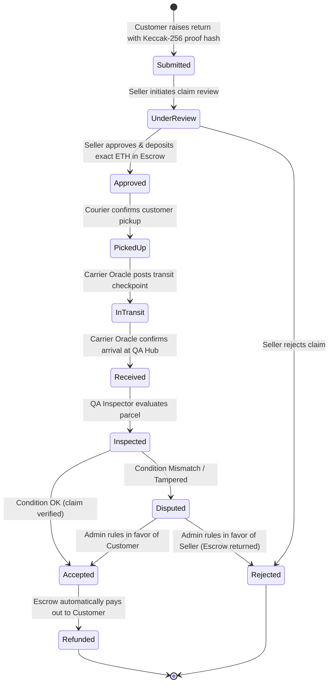

<<<<<<< HEAD
# 🔄 NexReturn: Decentralized Product Return & Escrow Protocol

A blockchain-based digital product return management and automated escrow refund system built on Ethereum and Hardhat.

---

## 📖 Overview

In traditional e-commerce, the return process is fraught with friction, lack of transparency, shipping delays, and fraud risks for both sellers and customers. **NexReturn** replaces centralized return processing with an immutable multi-stakeholder smart contract protocol:

1. **ProductRegistry**: Verifies genuine retail purchases on-chain between sellers and customers.
2. **ReturnRequest Lifecycle**: Coordinates multi-role state progression across 11 discrete stages with cryptographic proof verification.
3. **RefundEscrow & Dispute Arbitration**: Locks seller refund funds in non-custodial smart contract escrow and automatically distributes payouts upon passed QA inspections or admin arbitration.

---

## 🏛️ System Architecture & Roles

The protocol connects five core participants and an automated oracle:

| Role | Responsibility | Key Smart Contract Functions |
| :--- | :--- | :--- |
| **👑 Admin (Deployer)** | Ecosystem governance, role authorization, dispute arbitration | `addSeller`, `addLogistics`, `addInspector`, `addOracle`, `resolveDispute` |
| **🏪 Seller** | Registers authentic orders, reviews returns, approves & locks escrow in ETH, rejects invalid claims | `registerPurchase`, `reviewReturn`, `approveReturn`, `rejectReturn` |
| **🛍️ Customer** | Raises return claims with cryptographic evidence hashes, claims instant refunds upon QA pass | `raiseReturn`, `releaseRefund`, `verifyPurchase` |
| **🚚 Logistics Partner** | Collects parcel from customer and confirms physical pickup | `confirmPickup` |
| **🛰️ Tracking Oracle** | Carrier bridge (FedEx/DHL) simulating real-time GPS transit and delivery checkpoints | `updateShipment(returnId, false)`, `updateShipment(returnId, true)` |
| **🔍 Quality Inspector** | Assesses physical product condition, packaging, and hardware serial authenticity | `markInspected(returnId, conditionOk)` |

---

## 🔄 The 11-Stage Return Lifecycle



---

## 🚀 Quick Start Guide

### 1. Run Smart Contract Test Suite
Verify all 18 automated unit and integration tests covering the complete happy path, role authorization boundaries, wrong-state reverts, and dispute settlements:
```bash
npm test
```

### 2. Run the Interactive Console Demo
Simulates an end-to-end return lifecycle and dispute arbitration in your terminal:
```bash
npm run demo
```

### 3. Deploy to Local Blockchain Node
Start the local Ethereum RPC node in one terminal:
```bash
npm run node
```

In a second terminal, deploy the contract and seed demo data:
```bash
npm run deploy
```

This deploys `ReturnManagement.sol`, authorizes test participants, seeds sample orders, and generates configuration files for the frontend and oracle:
- `artifacts/deployedAddress.json`
- `frontend/js/contractConfig.js`
- `oracle/oracleConfig.json`

### 4. Start the Automated Shipment Tracking Oracle
Starts the carrier tracking oracle service to bridge courier tracking events with on-chain checkpoints:
```bash
npm run oracle
```

### 5. Launch the Web Application
Start the modern, responsive Web3 dApp:
```bash
npm run frontend
```
Open **[http://localhost:5173](http://localhost:5173)** in your browser.

---

## 💻 Web Application Features

- **Multi-Persona Switcher**: Seamlessly switch between all 6 roles (Customer, Seller, Logistics, Inspector, Oracle, Admin) with instant Hardhat local account simulation.
- **Client-Side Proof of Return Vault**: Drag-and-drop defective item photos to compute Keccak-256 cryptographic hashes client-side before on-chain submission.
- **Interactive 11-Stage Visual Stepper**: Glowing status progression bar tracking returns across all lifecycle nodes with full audit trails.
- **Escrow Vault Monitor**: Real-time visualization of locked escrow balances and instant refund releases.
- **Live On-chain Event Stream**: Real-time event subscriber displaying incoming transactions and state changes.

---

## 📁 Repository Structure

```
├── contracts/
│   └── ReturnManagement.sol       # Core multi-role escrow & lifecycle contract
├── test/
│   └── ReturnManagement.test.js  # 18 comprehensive Mocha/Chai test suites
├── scripts/
│   ├── deploy.js                  # Deployment & demo data seeding script
│   ├── demo.js                    # End-to-end interactive terminal simulation
│   └── serve.js                   # Lightweight static HTTP server for frontend
├── oracle/
│   └── shipmentOracle.js          # Courier tracking oracle service
├── frontend/
│   ├── index.html                 # Main application UI
│   ├── css/
│   │   └── style.css              # Modern dark-mode glassmorphic design system
│   ├── js/
│   │   ├── app.js                 # Frontend Web3 & dApp controller
│   │   └── contractConfig.js      # Auto-generated contract deployment metadata
│   └── ethers.umd.min.js          # Standalone bundled Ethers.js v6
├── hardhat.config.js              # Hardhat configuration (Solidity 0.8.24)
└── package.json                   # Project dependencies and script commands
```
=======
# Blockchain_Project
>>>>>>> 75de3fbd8c29399621f11d10dcc73cc009d1c9f6
